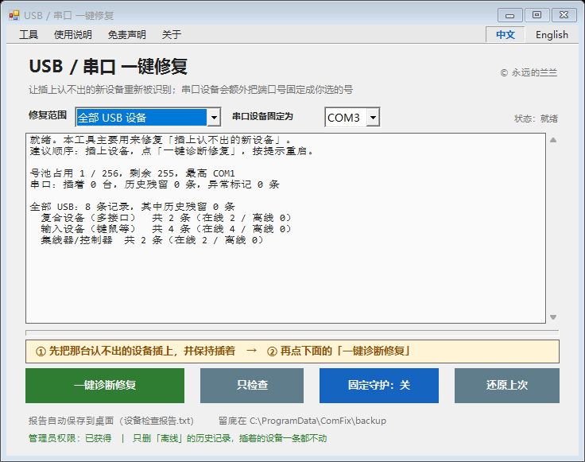
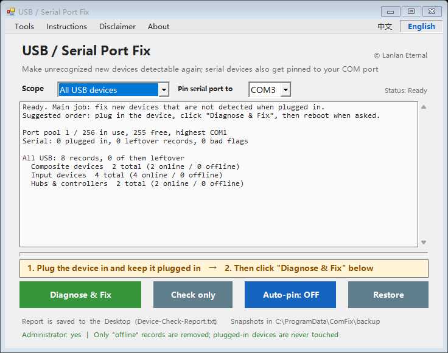

# USB / 串口 一键修复 &nbsp;·&nbsp; USB / COM Port One-Click Fix

<p align="center">
  <b>简体中文</b> &nbsp;|&nbsp; <a href="README.en.md">English</a>
</p>

> 让插上认不出的 USB / 串口设备重新被识别，并把串口号固定到你指定的 COM。
> Make an undetected USB / COM device detectable again, and pin it to a fixed port.

<p align="center">
  <a href="https://github.com/podcatcher962/usb-com-fix/releases/latest">
    
  </a>
</p>

<p align="center">
  <b>直链 / Direct link：</b><br>
  <a href="https://github.com/podcatcher962/usb-com-fix/releases/download/v3.2.0/usb-com-fix-v3.2.0.zip">
    https://github.com/podcatcher962/usb-com-fix/releases/download/v3.2.0/usb-com-fix-v3.2.0.zip
  </a>
</p>

<p align="center">
  <sub>解压 → 双击「请双击这个-USB串口一键修复.bat」→ UAC 点「是」→ 点「一键诊断修复」，取证和修复一次做完</sub>
</p>

<p align="center">
  
</p>
<p align="center">
  
</p>

<p align="center">
  
  
  
  
  
</p>

---

## 这是什么

一台 Windows 电脑长期高频插拔 USB 设备（USB 转串口、开发板、烧录器、测试治具、读卡器、USB 网卡……），
设备记录会越积越多、越积越乱，最终出现这一组典型症状：

- 插上 USB 设备，**设备管理器里一条都不多**，连个黄色感叹号都不给
- 或者多出一个「未知设备」，带黄色感叹号，属性里代码 10 / 43
- 以前插过的设备现在还能用，**没插过的一概没反应**
- 删掉设备、重启，能认一次，再插又不认
- 重装系统能好一阵，几周后又复发
- 换别的电脑一切正常，只有这一台不行
- 串口号跳来跳去（COM3 → COM7 → COM11），跟软件的配置对不上
- COM 号被占用，或者插上根本不给号

这个工具就是针对这一组症状做的：**一次点完，把挡路的全清掉，该固定的固定回去。**

它不是"清理软件"，清理只是手段；**目的是让设备能被正常认出来。**

> 产线 / 工控环境最容易踩到最后一类：早年为了固定端口号，用 bat 或手工注册表
> 按硬件 ID 写了 `PortName`，却没同步系统那张号池位图 —— 这正是「新设备完全认不出」的经典成因，
> 详见 [为什么"固定端口号"会把自己搞坏](#为什么固定端口号会把自己搞坏)。

---

## 七步修复

点一次「一键诊断修复」（或菜单「工具 → 直接修复」跳过取证），依次执行：

| # | 步骤 | 说明 |
|---|---|---|
| 1 | **留底** | 原始状态完整存一份，随时能一键还原 |
| 2 | **修系统层拦路项** | 设备安装策略禁止装新设备、`Enum` 权限被改坏、设备类过滤驱动残留、USB 存储驱动/设备安装服务被停用、驱动搜索被设成"从不安装"、设备安装日志（`setupapi.dev.log`）涨到十几 MB 时自动轮转 |
| 3 | **清理离线残留记录** | 已拔掉的设备记录，它们占着位置不放，新设备就进不来 |
| 4 | **清除异常标记** | `安装失败` / `待重装` 标记，新设备装不上常常卡在这一条 |
| 5 | **修正 COM 号占用表** | `COM Name Arbiter` 位图与实际不符时，新设备分不到号 |
| 6 | **重新扫描硬件** | 让系统重新识别一遍 |
| 7 | **固定串口号** | 把当前插着的设备固定到你选的号（默认 COM3） |

**第 3～5 步只清「不在线」的记录。** 正在用的设备一条都不动。

### 修复范围（界面上可选，四种）

| 范围 | 清什么 | 什么时候用 |
|---|---|---|
| 串口设备（COM 口） | 只清串口类 | 确定是 USB 转串口机型 |
| 厂商自定义设备 | 只清 `Vendor` / `Composite` | 烧录器、测试治具这类 |
| **全部 USB 设备（默认）** | 上面两种都覆盖，不含 HID | 不确定机型时用这个 |
| 全部 USB 设备（含 HID） | 再加上 HID 的离线记录 | 新机型走 HID 免驱（设备管理器里在「人体学输入设备」下） |

无论选哪个范围，键鼠、声卡、摄像头、网卡、打印机、集线器、控制器都受保护，不会被删。

> 纯 USB 设备（没有 COM 口的）同样适用：第 5、7 步会自动跳过，第 2～4、6 步照常生效。
> 判断能不能修，看「工具 → 深度取证」报告第 7 节：有该 VID/PID 的 `FAILURE(0x...)` 就是安装链被挡（能修）；
> 连安装尝试都没有记录，说明设备根本没被枚举到（属硬件/描述符层面，软件修不了）。

---

## 为什么"固定端口号"会把自己搞坏

这是本项目最想讲清楚的一件事。

Windows 管串口号靠两张表：

| | 位置 | 作用 |
|---|---|---|
| **① 设备名牌** | 每条设备记录的 `Device Parameters\PortName` | "我是 COM3" |
| **② 总台账** | `HKLM\SYSTEM\CurrentControlSet\Control\COM Name Arbiter\ComDB` | 32 字节位图，256 个位，记着哪些号已被占 |

**用设备管理器改号，Windows 会把两张表一起处理。**
**手工改注册表（或网上那种"按 VID/PID 批量写 PortName"的 bat），只改了①，没动②。**

于是：设备说"我是 COM3"，台账说"COM3 没被占"，新设备来要号时台账分给它一个号，
正好撞上名牌上写死的号 → Windows 直接不让它启动 → **设备管理器不认。**

这就是"插过的还能用、没插过的一律没反应"的根源。

本工具的做法是走官方那条路径的逻辑：

| | 网上/bat 那种 | 本工具 |
|---|---|---|
| 按什么找 | VID/PID，该型号**所有**历史实例 | **实例 ID**，只用「当前在线」那一条 |
| 改什么 | 只写 `PortName` | `PortName` **＋** 同步 `ComDB` |
| 设备不在场 | 照样写（动的是死记录） | 不写 |
| 冲突 | 不知道，一堆记录都写 COM3 | 目标号被占 → **跳过并提示** |
| 生效 | 重启系统 | 重启那一台设备（秒级） |

---

## 安全边界

- ✅ **只删离线记录**，插着的设备不动
- ✅ **判断不准就不删**：拿不到在线设备列表时整步跳过并报警
- ✅ **根集线器自检**：连主板集线器都被判成离线，说明判断本身出错 → 拒绝删除
- ✅ **祖先保护**：复合设备的子接口里有键鼠等受保护设备时，父设备也跳过
- ✅ **集线器/控制器、键鼠、声卡、摄像头、网卡、打印机一律不碰**
- ✅ **全程留底**：`C:\ProgramData\ComFix\backup\`，菜单「还原上次」可退回
- ⚠️ **不自动删「按硬件 ID 封禁」**（`DenyDeviceIDs`）。那多半是 IT 有意设的，只提示不动手

---

## 使用方法

```
1. 解压，双击「请双击这个-USB串口一键修复.bat」
2. 弹权限 → 点「是」（需要管理员权限才能改设备记录）
3. 把那台认不出的设备插上，保持插着（**必须先插，再点按钮**）
4. 点「一键诊断修复」—— 先只读取证，判出可修的原因就直接接着修（不再弹第二遍确认）
5. 弹窗问是否重启 → 点「是」（点「否」的话，按钮上方的横条会变橙色常驻提醒，
   右边多一个「立即重启」按钮，一直挂着直到真的重启）
6. 重启后插一台新设备，看认不认
```

**「一键诊断修复」是首页从左数第二个按钮。** 它先做一遍深度取证（只读），
报告末尾有一条 `[VERDICT]` 判定行，工具据此自己决定要不要动手：

| 判定 | 依据 | 工具行为 |
|---|---|---|
| **可修** | 安装策略禁止装新设备 / 安装日志里最近一次 `FAILURE(0x...)` / 当前有「未知设备」/ 过滤驱动残留 / 有「安装失败、待重装」标记 | **直接接着修**，不再多问一遍（修复前照旧留底） |
| **系统没枚举到** | 没有任何未知设备，且安装日志里没有该设备的记录 | **只出报告，一个字都不改** —— 这类问题在端口 / 线材 / 供电层 |

**强烈建议先插设备，再点按钮。** 界面上按钮正上方有一条黄底横条一直在提醒这件事，
认出设备后会变成绿底「已插着 N 台设备」。原因很实在：取证里最关键的一项
就是「系统到底有没有看到这台设备」，设备不在场，这一项就是空的，判不出原因。

不插也能跑（相当于"清场"，第 1～6 步照常执行），只是这种情况日志会先提醒一句。

菜单 **工具** 下还有两项，给需要精细控制的场景：

- **直接修复（跳过取证）** —— 不做那 20 秒取证，直接按七步修；日常反复修时用
- **只出取证报告** —— 只取证、只出报告，一个字都不改

**首页只保留一个修复入口**，就是为了现场不用纠结"该点哪个"。

### 修复后按三种情况判断

```
插上一台新的空片
  ├─ 认出来了，号也正好是目标号   →  完成，正常生产
  ├─ 认出来了，但号不是目标号     →  点「固定守护」，2 秒内自动改
  └─ 还是完全不认                 →  点「一键诊断修复」；仍不行就把报告发出来
```

---

## 固定守护

点「固定守护：关」→ 按钮变红 → 进入常驻监听。
之后**每插一台新设备，2 秒内自动固定到目标号**，不用再碰注册表。

---

## 纯 USB 设备 vs 串口设备

先澄清一个常见误解：**纯 USB 设备不等于 HID 设备**。HID 只是其中一种
（键盘、鼠标、手柄、自定义 HID 板卡）；还有厂商自定义设备（WinUSB / libusb，
烧录器和测试治具多数属于这类）、大容量存储、网卡、声卡、摄像头、打印机。
它们的共同点是 **Windows 不给它分配 COM 号**。

工具按「每条记录自己属于哪一类」分流，不是按你选的范围一刀切：

| 设备类型 | 清离线记录 | 写端口号 / 固定号 |
|---|---|---|
| 串口（COM 口） | 会 | 会 |
| 厂商自定义 / HID / 存储 / 网卡 / 声卡 | 会（选含 HID 档才清 HID） | **不会，绝不写** |
| 集线器 / USB 控制器 | 不会 | 不会 |

写端口号有两道闸：

1. **候选只从串口类取** —— HID、厂商自定义、存储、网卡根本进不了候选名单
2. **还要再过一道硬检查** —— 设备必须已有系统分配的 COM 号，或设备类本身就是
   `Ports`。两条都不满足就直接跳过，一个字节都不写

所以纯 USB 设备**不会被写端口号，也不会在 COM 号池里占位**。它只享受
「清掉离线旧记录」和「修好系统层拦路项」这两个好处——对它是纯收益，没有副作用。
转 COM 口的老机型照旧固定号，两类设备插在同一台电脑上互不影响。

### 一个软件绕不过去的物理约束

没有序列号的 USB 设备，Windows 是**按「插在哪个 USB 口」**来生成设备记录的：

```
同一台设备，插 1 号口 → 一条记录（已固定成 COM3）
同一台设备，插 2 号口 → 另一条记录（会被当成新设备，重新分号）
```

这是 Windows 的规则，不是工具的缺陷。所以：

- 固定端口号的前提是**固定插同一个 USB 口**，工位最好贴标签
- 必须换口时，把「固定守护」开着，插上 2 秒内自动改回目标号
- 绑 VID/PID 固定号对「同一型号的所有机器」有效，因为它们共用同一套记录
  ——这也正是原来那个 bat 一直好用的原因

---

## 双语

菜单栏**右侧有「中文 | English」两个按键**，当前语言是蓝色加粗的，点一下整个窗口切换。
不设「语言」下拉菜单——英文使用者不必认识中文的「语言」二字，看到 `English` 就能直接点。

切换范围：标题栏、菜单栏其余项、按钮、下拉框、状态栏、日志、所有提示框、三个说明对话框，
**连生成的报告文件都是对应语言**。选择会记住，下次打开还是这个语言。

首次启动按系统语言自动选择。

---

## 兼容性

| 项目 | 支持 |
|---|---|
| 系统 | Windows 7 / 8 / 8.1 / 10 / 11，含 LTSC |
| 架构 | 32 位 / 64 位 |
| 运行库 | 只用系统自带 .NET Framework 与 PowerShell 5.1，**不需要装任何东西** |
| 网络 | **完全不联网** |
| 安装 | 免安装，解压即用 |

小屏幕（1024×768 / 1280×1024）会自动按工作区等比缩小；实在太小会出滚动条，不会出现按钮点不到。

---

## 报告

跑完自动写到桌面：

| 文件 | 什么时候生成 |
|---|---|
| `设备检查报告.txt` | 每次「只检查」、「一键诊断修复」或「直接修复」后刷新 |
| `USB修复-出错报告.txt` | 出错时生成，带行号、调用栈、操作日志 |
| `USB修复-启动失败.txt` | 程序连窗口都没起来时生成 |

报告内容：COM 号池用量、各类 USB 设备记录数、离线数、积累最多的型号 TOP 15、
系统层各项状态、本次操作逐条结果。

---

## 一键诊断修复 / 深度取证

**首页按钮「一键诊断修复」** = 深度取证 + 判出可修原因就立刻修复，一次点击做完。
**菜单「工具 → 只出取证报告」** = 只取证，不自动修（想要一份纯报告时用）。

取证本身**只读**：不改任何设置、不删任何记录，唯一写操作是建一个临时注册表键、建完立刻删掉。

插着那台认不出的设备跑，报告十节：

1. 系统与权限
2. COM 号池位图
3. USB 设备记录统计（有序列号 / 无序列号）
4. 错误代码清单
5. 当前 USB 设备（`Win32_PnPEntity`）
6. 设备安装策略（组策略那条）
7. Windows 驱动安装日志（`Exit status` 成功还是 `FAILURE(0x...)`）
8. `Enum\USB` 写入实测
9. 服务与驱动缓存状态
10. **结论** —— 只看这一节就够

---

## 文件结构

```
usb-com-fix/
├─ src/
│  ├─ comfix-gui.ps1          界面、双语、菜单
│  ├─ comfix-core.ps1         七步修复、留底还原、报告
│  ├─ usbprobe.ps1            深度取证（只读）
│  └─ report-launch-fail.ps1  启动失败兜底报告
├─ docs/
│  ├─ screenshot-zh.png
│  └─ screenshot-en.png
├─ 使用说明（先看这个）.txt
├─ build.py                   打包成可分发的目录 + zip（bat 由它生成）
├─ LICENSE
└─ README.md
```

---

## 自己打包

```bash
python build.py
```

生成 `USB串口一键修复/` 与同名 `.zip`（`ROOT` 常量可改，想换个目录名就改它）。
`build.py` 里负责把 `.ps1` 转成 **UTF-8 BOM + CRLF**、把 `.bat` 转成 **GBK**——
PowerShell 5.1 和 cmd 对编码的要求不一样，这两步不能省。

---

## 已知限制

- **硬件层修不了**：端口物理损坏、供电不足、控制器驱动损坏，这些超出软件能处理的范围
- **驱动匹配失败**：如果空片需要的驱动系统里根本没有，得先装驱动
- **`DenyDeviceIDs` 封禁**：检测得到，但不自动删
- **在别人的机器上没验证过**：本项目在本机做过完整逻辑验证（试运行、ACL 单元测试、
  在线/离线判定、纯 USB 设备拒绝写号的硬检查），但"删记录→改号→重启设备生效"
  这一段只有在真实故障机上跑才是真考验
- **换 USB 口会导致固定号失效**：无序列号设备的记录按端口位置生成，这是 Windows 的规则，
  软件绕不过去。保持插同一个口，或开着「固定守护」

---

## 许可

MIT License · 详见 [LICENSE](LICENSE)

---

## 免责声明

**请在使用前完整阅读本节。使用本工具即表示你已理解并接受以下全部条款。**

1. **系统级操作**：本程序会修改 Windows 注册表（设备记录、`COM Name Arbiter` 号池位图）、
   设备安装策略、设备安装日志与部分设备状态。这类操作本身带有不可完全消除的风险。
2. **无担保**：本程序按「现状」提供，不附带任何明示或暗示的担保，包括但不限于适销性、
   特定用途适用性与不侵权的担保。作者不承诺本程序能修复任何特定故障，也不承诺零副作用。
3. **责任限制**：在适用法律允许的最大范围内，作者不对因使用或无法使用本程序而导致的
   任何直接、间接、附带、特殊或后果性损失承担责任，包括但不限于数据丢失、设备异常、
   生产中断、工期延误与商业利润损失。
4. **请先小范围验证**：正式部署前，**务必先在一台机器上验证**，确认有效且无不良副作用后再批量使用。
   关键设备请自行创建系统还原点或完整备份。程序内已提供「还原上次」，但不构成数据安全保证。
5. **不涉及的范围**：本程序不修改固件、不刷写芯片、不改变被修设备本身，也不修改任何生产或业务软件。
   硬件故障（端口损坏、供电不足、控制器故障）不在本程序的处理范围内。
6. **合规使用**：请仅在你拥有管理权限、且获得授权使用的计算机上运行本程序。
   因超出授权范围使用而产生的后果由使用者自行承担。
7. **条款不接受**：若你不同意上述任一条件，请立即停止使用并删除本程序全部文件。

---

## Disclaimer

**Read this section in full before use. Using this program means you understand and accept all terms below.**

1. **System-level changes.** This program modifies the Windows registry (device records, the
   `COM Name Arbiter` port bitmap), device installation policy, the device setup log, and the state
   of some devices. Such operations carry risks that cannot be fully eliminated.
2. **No warranty.** The program is provided "AS IS", without warranty of any kind, express or implied,
   including but not limited to the warranties of merchantability, fitness for a particular purpose,
   and non-infringement. The author does not guarantee that it will fix any specific fault, nor that
   it is free of side effects.
3. **Limitation of liability.** To the maximum extent permitted by applicable law, the author shall not
   be liable for any direct, indirect, incidental, special, or consequential damages arising from the
   use of, or inability to use, this program — including but not limited to loss of data, device
   malfunction, production downtime, schedule delays, and loss of business profits.
4. **Validate on one machine first.** Before rolling out, **test on a single machine** and confirm it
   works without adverse side effects. Create a system restore point or a full backup on critical
   machines. The built-in "Restore last" function is a convenience, not a guarantee of data safety.
5. **Out of scope.** This program does not modify firmware, flash chips, or the device being repaired,
   and does not touch any production or business software. Hardware faults (damaged ports,
   insufficient power, faulty controllers) are outside its scope.
6. **Authorized use only.** Run this program only on computers you own or are authorized to administer.
   You are responsible for any consequence of using it beyond that authorization.
7. **Not accepted?** If you do not agree with any of the above, stop using the program immediately and
   delete all of its files.

---

## 作者 / Author

**© 2026 永远的兰兰 · Lanlan Eternal**
